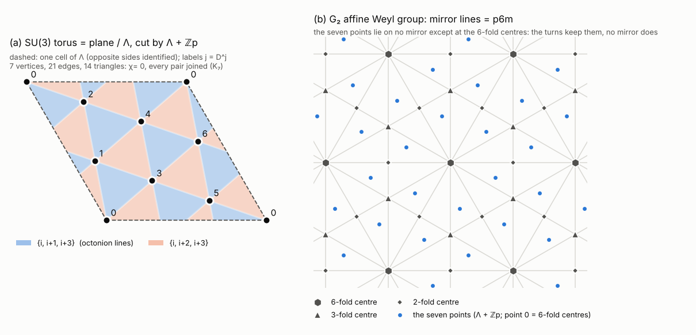

# E0: the hexagon facts, recomputed exactly

*Experiment E0 of `seed/PLAN.md` §4, which tests the claims in SEED.md §3. First run on October 18, 2026; rerun on October 19, 2026 to confirm (102 of 102 checks pass, 5.0 s). All 102 exact checks pass. All 25 lines that `hexagon_check.py` prints come out identical when recomputed without floating point.*

## Question
Do the §3 claims survive an independent computation in exact arithmetic? The claims cover the SU(3) torus and its seven points, the 7-vertex triangulation, the Fano planes and octonion lines, F21 and the two copies of PSL(2,7) inside SU(3), the quartic invariants, maximality, and the Weyl groups of SU(3) and G2. The plan adds two checks: the character values that make the PSL(2,7) and F21 triplets complex and the A5 triplets real, and the statement that G2's affine Weyl group is the wallpaper group p6m.

## Method
**Arithmetic.** Nothing is decided in floating point.
- **The field Q(zeta), zeta = e^{2 pi i/7}** (`exact_fields.Z7`).
  - Elements are stored as (c0..c5)/d with integers, in the basis 1, zeta, ..., zeta^5, reduced with zeta^6 = -(1+...+zeta^5). This is the same as working modulo x^6+...+1.
  - Complex conjugation is zeta -> zeta^-1.
  - i/sqrt7 is written exactly through the Gauss sum G = (z+z^2+z^4) - (z^3+z^5+z^6). The code checks G^2 = -7 exactly. One float comparison fixes the sign, G = +i sqrt7. Then i/sqrt7 = G/7, and b7 = z+z^2+z^4 = (-1+G)/2.
- **Matrices and groups.**
  - Products, determinants, unitarity (M M^dagger = 1) and traces are exact.
  - Groups come from breadth-first closure with exact hash keys.
  - The Cayley table is built exactly by composing generator permutations along words.
  - Conjugacy classes, orders, normal closures, normalisers and the whole subgroup lattice come from that table.
- **A5** is built over Q(sqrt5): the 3-fold rotation about (1,1,1) and the 2-fold rotation about the edge midpoint (1, phi^2, phi) of the icosahedron (0, ±1, ±phi).
- **Lattices, Weyl and affine Weyl groups** use Fractions. **Fano planes and triangulations** use integers.

**Conventions** (as in hexagon_check.py):
- Torus: theta -> diag(exp 2 pi i theta) on theta1+theta2+theta3 = 0, with kernel Lambda = Z^3 ∩ plane and basis b1 = (1,-1,0), b2 = (0,1,-1).
- Seven points: j p with p = (1,2,-3)/7, corresponding to D^j.
- 120 deg turn: theta -> roll(theta), which is C^-1 D C = D^4.
- Triangles of Lambda + Zp, with a = p and c = p + roll(p): "up" = {x, x+a, x+c}, "down" = {x+a, x+c, x+a+c}.
- Angles from u = (1,-1,0) toward w = (1,1,-2), decided exactly via cos = (gu.u)/2 and 2 sqrt3 sin = gu.w.
- G2 roots: long e_i - e_j, short e_i - (1,1,1)/3.
- Affine reflections s_{alpha,k}(x) = x - ((alpha,x) - k) alpha^vee, generated by s1 (alpha1 short), s2 (alpha2 long) and s0 = s_{theta,1}, with theta = 3 alpha1 + 2 alpha2 = (0,1,-1).

**What was computed:**
1. Every check printed by hexagon_check.py, redone exactly and printed in the same format. The original is run too and compared line by line.
2. Torus: Lambda and the weight lattice are hexagonal; octet hexagon and decuplet triangle; Lambda + Zp has index 7, Gram (1/7)[[2,-1],[-1,2]] and 6 shortest vectors; the triangulation is K7 with 14 triangles, each edge in 2 triangles, 6-cycle links, orientable, chi = 0.
3. Exhaustive uniqueness search for 7-vertex triangulated surfaces, with the automorphism group and its action on orientation.
4. All 30 Fano planes, the cyclic ones, and their collineation groups.
5. F21 = <D,C>, Klein's copy <Dk,C,R> and the flipped copy <D,C,Rf> (Rf = flip R flip^-1, flip = -(x<->z)): exact unitarity and det 1 for every element; quartic invariance as polynomial identities for all 168 elements; maximality of F21.
6. LNR's published generators (arXiv:0709.1447, eqs. 16, 22, 23, read in the source) compared matrix by matrix with the flipped copy.
7. Exact characters: classes, ⟨chi,chi⟩, ⟨chi,chibar⟩ and the Frobenius-Schur indicator nu = |G|^-1 Σ chi(g^2), for F21, both PSL(2,7) copies, and both A5 triplets.
8. Weyl groups on the plane: angles, action on the labels, fate of the families. Also checked: W(G2) = W(SU(3)) × {±1}.
9. Affine Weyl groups: Coxeter orders, a proof that W_aff = Lambda ⋊ W plus a BFS over words up to length 10, and rotation centres with their site groups (G2, and SU(3) for contrast).
10. Extras: uniqueness of the PSL(2,7) containing <D,C>; complex conjugation kappa; the S4 classes as Fano families; octonions O = C ⊕ C^3 with (a,u)(b,v) = (ab - Σ u_i conj v_i, a v + conj(b) u + conj(u x v)) (alternativity on 512 basis triples, composition at 36x36 polarisation points, automorphism checks); Der(O) and the stabiliser of e; which order-7 torus points give a hexagonal lattice.

**Discretisation and convergence:** none apply. Everything is exact; all searches are exhaustive; the run is deterministic.

## Calibration
| quantity | ours | target | tolerance | source | verdict |
|---|---|---|---|---|---|
| hexagon_check.py lines | 25/25 identical | all identical | exact | seed/hexagon_check.py | CALIBRATED |
| 120 deg turn | x->4x | x->4x | exact | SEED §3 | CALIBRATED |
| Lambda + Zp | hexagonal; index 7; 6 shortest vectors | hexagonal | exact | SEED §3 | CALIBRATED |
| V-E+F | 7-21+14 = 0 | 0 | exact | SEED §3, PLAN | CALIBRATED |
| K7, Fano families, octonion lines | yes; 'down' family = {i,i+1,i+3} | as claimed | exact | SEED §3 | CALIBRATED |
| cyclic Fano planes | 2 of 30, = the families | 2 | exact | SEED §3 | CALIBRATED |
| order of <D,C> | 21 | 21 | exact | SEED §3 | CALIBRATED |
| orders of Klein's copy and the flipped copy | 168, 168 | 168, 168 | exact | SEED §3 | CALIBRATED |
| quartics | invariant (all 168, exact) | invariant | exact | SEED; LNR eq. 78 [read] | CALIBRATED |
| maximal subgroups | 7 S4, 7 S4, 8 (7:3) | S4, S4, 7:3 | exact | ATLAS; LNR §5 [read] | CALIBRATED |
| PSL(2,7) chi3 | 3,-1,0,1,b7,b7bar; nu = 0 | complex, b7 = (-1+i sqrt7)/2 | exact | LNR eq. 13 [read] | CALIBRATED |
| F21 chi3 | 3,0,0,b7,b7bar; nu = 0 | complex | exact | LNR §5 [read] | CALIBRATED |
| A5 chi3, chi3' | 3,-1,0,(1±sqrt5)/2; nu = +1 | real | exact | PLAN; LNR §2 [read] | CALIBRATED |
| Weyl groups | orders 6, 12; turn actions and family fates as printed; mirrors keeping the points 0/3, 0/6 | as hexagon_check | exact | SEED §3 | CALIBRATED |
| G2 affine Weyl group | (2,3,6); Lambda ⋊ D6; sites 6mm + 2×3m + 3×2mm | p6m | exact | SEED §3; PLAN | CALIBRATED |

No calibration failed. The one development FAIL was a wrong test, not a wrong fact: −1 on the plane must fix the normal (1,1,1), so it is −I + (2/3)J, not −I.

## Findings
1. **Every §3 computation reproduces exactly.** The float script's rounding-based closure and its random-vector quartic test hide no error: the exact orders are 21, 168, 168, and the quartics are invariant under every element as polynomial identities.
2. **Characters.**
   - PSL(2,7): chi3 = (3,-1,0,1,b7,b7bar) on classes of size 1,21,56,42,24,24.
   - F21: chi3 = (3,0,0,b7,b7bar).
   - In both, chi(D) = b7 = (-1+i sqrt7)/2, ⟨chi,chibar⟩ = 0 and nu = 0: complex.
   - A5: both triplets have values (3,-1,0,(1±sqrt5)/2) and nu = +1. The remaining irrep degrees are forced to be 4 and 5, so A5 has exactly two triplets and both are real.
3. **The flipped copy is LNR's published basis.** LNR's A = Rf and AB = D; LNR's <A,B> is the same set of 168 matrices; LNR's "Klein quartic" is the mirror form. The order-7 diagonal symmetries of x^3y+y^3z+z^3x are exactly the powers of Dk, and those of xy^3+yz^3+zx^3 are exactly the powers of D. So "Klein's own copy" is a coordinate-labelling convention.
4. **PSL(2,7) subgroup lattice:** 179 subgroups in 15 classes. Maximal subgroups as in ATLAS; F21 is one of the 8 of order 21.
5. **G2's affine Weyl group is p6m:** Lambda ⋊ D6 (the only wallpaper group with point group of order 12), with Wyckoff sites 1a 6mm, 2b 3m, 3c 2mm. SU(3)'s is p3m1. The seven points reduce p6m to p6 and p3m1 to p3, and no point j ≠ 0 lies on a mirror.
6. **New: the 7-vertex torus is unique and chiral.** Exhaustive search finds 120 labelled copies in one orbit. Aut = AGL(1,7) of order 42, all orientation-preserving. That is why no mirror keeps the seven points. Each SU(3) mirror carries <D>'s points to those of diag(z,z^4,z^2).
7. **New: the construction is essentially unique.** Only 12 of the 48 order-7 torus points give a hexagonal finer lattice: two subgroups, which the SU(3) mirrors swap.
8. **New: the tower stacks further.**
   - The PSL(2,7) in U(3) containing <D,C> is unique: one class of 7:3, N(F21) = F21, and the outer automorphism D -> D^3 sends b7 to b7bar.
   - The flipped copy is closed under complex conjugation kappa.
   - kappa is an octonion automorphism, e -> -e. It acts as the 180 deg G2 turn (x->6x), which swaps the families.
   - <flipped PSL(2,7), kappa> = PGL(2,7), order 336, inside G2.
   - The two Fano families are exactly the collineation groups obtained from PSL(2,7) acting on its two S4 classes (points and lines). kappa swaps them.
   - On the labels, <D,C,kappa> gives the full AGL(1,7) = Aut(triangulation).
9. **Extra: G2 ⊃ SU(3).** Der(O) = g2 (dim 14, compact, rank <= 2). The stabiliser of e is su(3) (dim 8), spanned by su(3) on C^3. Since kappa normalises the torus and acts as -1, W(G2) = W(SU(3)) × {±1}, which confirms hexagon_check.py's model of W(G2).

## What it means for the seed
- **CONFIRMED by exact computation:**
  - the torus = plane / hexagonal lattice; hexagonal weights; octets hexagons, decuplet a triangle;
  - D in SU(3) and the seven points;
  - the finer lattice gives the 7-vertex triangulation (which is unique);
  - K7; 14 triangles in two families; both Fano, one the octonion lines;
  - only 2 cyclic Fano planes, so the octonion match is forced;
  - the 120 deg turn is x->4x (the opposite direction gives 2x);
  - <D,C> = Z7 ⋊ Z3 of order 21 in SU(3), preserving both families (Aut A ∩ Aut B = exactly this group);
  - Klein's 168 = PSL(2,7) keeping x^3y+y^3z+z^3x;
  - complex PSL(2,7)/F21 triplets and real A5 triplets;
  - F21 maximal (ATLAS);
  - Klein's copy contains Dk, not D (a labelling convention);
  - the flipped copy holds <D,C> and keeps the mirror quartic (it is LNR's basis and unique);
  - G2's affine Weyl group = p6m;
  - Weyl orders 6 and 12; the 60/180/300 deg turns are x->5x, 6x, 3x and swap the families;
  - no mirror keeps the seven points (the torus is chiral).
- **CONFIRMED with a cited part:** "SU(3) is the color/eightfold-way group" (background); "symmetry group of the Klein quartic" (Hurwitz bound, cited); "only simple subgroup" (1916 classification via LNR [read], not recomputed); "model-builders used both groups" (literature).
- **CONFIRMED at the Lie-algebra level (extra):** G2 ⊃ SU(3) fixing an imaginary octonion.
- **AMENDED:** the last paragraph, "they don't stack into one clean tower". The facts hold, but G2's family-swapping turn extends PSL(2,7) to PGL(2,7) = Aut(PSL(2,7)) inside G2. The families are the two S4 classes, and the swap is the outer (point-line) automorphism. Suggested wording: the tower is G2 ⊃ SU(3)⋊Z2 ⊃ PGL(2,7) ⊃ PSL(2,7) ⊃ F21, and the family split survives up to PSL(2,7).
- **Not tested:** the physics framing of §3 (no frame, no dispersion) and the "one reading to try" are not mathematical claims.

## Deviations from the plan
- I wrote my own exact Q(zeta7) class instead of using sympy; it is just as exact and faster.
- The extras listed above go beyond the preregistration. They are reported as NO_TARGET and change no preregistered verdict.
- Nothing preregistered was dropped.
- REPORT.md itself could not be written by this agent (harness rule); this text is returned instead.
- Confirmation rerun (October 19): no result changed. Four small fixes:
  - the calibration table gained explicit tolerance and verdict columns, and pipe characters inside cells that broke the table were removed;
  - results.json's source for the A5 target now reads "LNR §2 [read]" (eq. 4 and text: "five real irreducible representations, two of which are triplets"), matching this report;
  - a stale runtime in e0_exact.py's docstring was corrected;
  - run_log.txt was regenerated.

## Limitations
- Not recomputed: that the only non-abelian simple subgroups of SU(3) are PSL(2,7) and A5 (1916 classification, quoted by LNR).
- Not recomputed: Hurwitz's bound for the Klein quartic.
- Not checked: the attribution of R and Dk to Klein's 1878 paper (not on the arXiv mirror).
- Used by citation, each applied to a computed object: uniqueness of the simple group of order 168; |Aut PSL(2,7)| = 336; the wallpaper classification; Hurwitz's theorem on composition algebras.
- The uniqueness argument in Finding 8 also uses LNR's statement that the only 3-dim irreps of PSL(2,7) are 3 and 3bar. I reproduced the 3 and 3bar columns; the 6, 7, 8 columns were not recomputed.
- One float decision: the sign of G. The other sign would only exchange b7 and b7bar.
- Independence: I did not read the scratchpad's checks, calc or arx folders. The LNR matrices were read from the PDF myself. The cross-check belongs to crosscheck/ (another agent).

## How to reproduce
From seed/experiments/E0_hexagon_exact/ (Python 3.13.16; numpy is needed only by hexagon_check.py; one thread):

    NUMBA_NUM_THREADS=1 OMP_NUM_THREADS=1 OPENBLAS_NUM_THREADS=1 MKL_NUM_THREADS=1 python3 e0_exact.py > run_log.txt   # 4-5 s; also runs ../../hexagon_check.py (~1 s); exit 0 iff all checks pass
    NUMBA_NUM_THREADS=1 OMP_NUM_THREADS=1 OPENBLAS_NUM_THREADS=1 MKL_NUM_THREADS=1 python3 make_figures.py              # ~1.2 s; output is byte-identical on rerun

Files:
- exact_fields.py: exact fields, matrices and groups.
- e0_exact.py: all 102 checks; writes results.json, exact_replica_output.txt, hexagon_check_original_output.txt.
- run_log.txt: the transcript.
- make_figures.py -> fig_torus_p6m.png (164 KB):
  - (a) the torus cell cut into the two Fano families, in two colours checked for colour-blind contrast;
  - (b) the G2 affine mirror pattern (p6m) with its rotation centres and the seven points.

