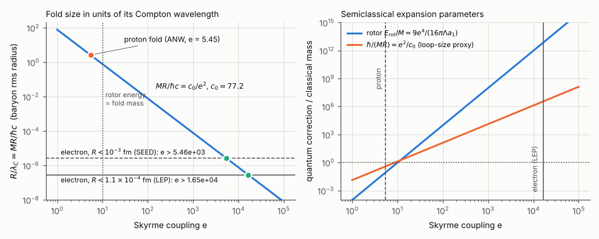
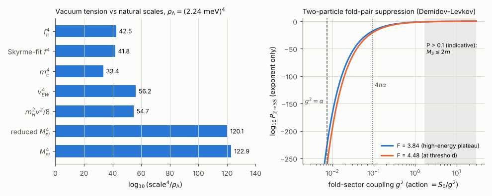

# E7 — Scale and coupling audit (SEED.md §8)

*Version 2, corrected after the independent cross-check (see "Reconciliation" at the end). Two numbers changed materially: the Demidov–Levkov high-energy exponent (3.93 → 3.84) and the hopfion energy-rms radius (2.144 → 2.061). Two CALIBRATED labels were withdrawn. No seed-claim verdict changed.*

## Question

SEED.md §8 lists places where the seed has to reach. Four of them can be turned into numbers.

1. **Size.** Can a fold be as small and as light as the electron and still be a classical fold?
2. **Pairs.** How rare is it to fold a few quanta into a fold–antifold pair, and at what coupling does it stop being rare?
3. **Vacuum tension.** How far is the observed tension from natural scales?
4. **Building the cone.** What does Weinberg–Witten (WW) forbid for a photon or graviton built from the field, and what does that mean for commitments 1 and 5?

PLAN.md §4 (E7) states the expected outcomes:

- Proton M·R/ħc ≈ 2.8.
- The semiclassical fold fails for the electron by a factor of at least 3.5 × 10⁶.
- This holds for any soliton whose classical action scales as 1/g².
- The vacuum ratios are about 3 × 10⁴² (f_π⁴), about 10⁵⁶ (electroweak) and about 10¹²³ (Planck).

Verdict words are those of PLAN §1, plus one:

- **CONSISTENT**: agrees with a reference that is not an independent, preregistered literature target, i.e. a PLAN expectation or a non-independent check. It does not count as a calibration.

## Method

### 1. Skyrme family (own solver, `e7_hedgehog.py`)

ANW conventions:

    L = (F_π²/16) Tr ∂U∂U† + (1/32e²) Tr[U†∂_μU, U†∂_νU]²

with U = exp(iτ·r̂ F), x = eF_π r, and F_π in the 186 MeV convention (ANW fit: 129 MeV). Then:

- Mass: M = a₁ F_π/e, with a₁ = 4π∫[x²F′²/8 + sin²F/4 + sin²F F′² + sin⁴F/(2x²)]dx.
- Moment of inertia: I₁ = (2π/3)Λ/(e³F_π), with Λ = ∫x² sin²F [1 + 4(F′² + sin²F/x²)]dx.

Four radius definitions, R = a₂/(eF_π):

| Definition | Formula |
|---|---|
| Baryon-density rms radius | ⟨x²⟩_B = −(2/π)∫x² sin²F F′dx |
| ANW isoscalar electric rms radius | Identical to the baryon rms radius by construction, because the isoscalar charge density is ρ_B/2 |
| ANW isoscalar magnetic rms radius | ⟨x²⟩_M = ∫x⁴ρ_B / ∫x²ρ_B |
| Energy rms radius | ⟨x²⟩_E = ∫x²ε / ∫ε |
| Half-baryon radius | Radius enclosing half the baryon number, where 1 − (F − sinF cosF)/π = ½ (that is, F = π/2) |

So M·R/ħc = a₁a₂/e² ≡ c₀/e².

A sympy substitution r = x/(eF_π) in the energy functional confirms that the prefactor is exactly F_π/e.

E7 solves its own hedgehog rather than reading E2's profile (deviation 9). It agrees with E2's profile to ≤ 10⁻⁹.

Discretization:

- The boundary-value problem is solved with scipy `solve_bvp` on x ∈ [10⁻⁴, X].
- Inner boundary condition: F(ε) = π + εF′(ε), the regular branch.
- Outer boundary condition: the Robin condition xF′ + 2F = 0 (the C/x² tail). With a pion mass, the Yukawa log-derivative is used instead.
- The tolerance is tightened progressively. The run converges at a relative residual of 10⁻⁷; 10⁻⁸ is not reached.
- Integrals use 4 × 10⁵-point trapezoid quadrature on the dense solution, plus analytic tails beyond X.

Convergence checks:

- X = 30, 60, 120, 240: relative spread ≤ 10⁻⁶ (Λ, the most tail-sensitive quantity, varies by 1 × 10⁻⁶).
- An independent shooting solver (DOP853, rtol 10⁻¹³, bisection on −F′(0)) gives slope 1.00376412, against 1.00376411 from collocation.
- Virial check: E₂/E₄ = 1.0000000. With a pion mass, Derrick's identity E₂ − E₄ + 3E₀ = 0 holds to ≤ 2 × 10⁻¹¹.
- Tail coefficient: F → C/x² with C = 8.6386, i.e. 2.160 in units of e f_π.

Pion-mass family: β = m_π/(eF_π) ∈ [0, 16], energy term (β²/4)x²(1 − cos F). This checks whether a mass term can make c₀ small.

Semiclassical parameters:

- Rotor correction: E_rot/M = (3/(8I₁))/M = 9e⁴/(16πΛa₁).
- Loop-size proxies: ħ/(MR) = e²/c₀, and the naive loop parameter e²/16π². The action is S₀/e², so ħ_eff = e².

Electron:

- Require M = m_e = 0.51099895 MeV (PDG 2026).
- Require R < 1.1 × 10⁻⁴ fm, or R < 10⁻³ fm (SEED).
  - The 1.1 × 10⁻⁴ fm is LEP's bound, read in Schael et al. 2013, Eq. 3.9.
  - That bound is model dependent: it converts the scale of a VV contact interaction (positive interference, electromagnetic coupling strength) into a size. It is not a direct form-factor measurement.
- Then e ≥ (c₀ħc/(m_e R))^{1/2} and F_π = m_e e/a₁.

### 2. Hopfion analogue (`e7_hopfion.py`, version 2)

The model has two couplings:

    E = ∫[(κ₂/2)(∂n)² + (κ₄/4)Σᵢⱼ(∂ᵢn × ∂ⱼn)²]

κ₂ has dimensions of mass² and κ₄ is dimensionless. Scaling out ℓ = √(κ₄/κ₂) gives:

- E = 16√2π² √(κ₂κ₄) E_W, where E_W is the Ward/Sutcliffe normalisation of E8.
- M·R = 16√2π² κ₄ E_W R̃ ≡ c₀ʰ κ₄.

So 1/g² ≡ κ₄, and κ₂ only sets the length unit.

Ansatz:

- n = U e₃ U†, with U the degree-1 hedgehog, so the Hopf charge Q = 1 exactly.
- Profile f(t) = (1 − t)² h(t), with t = r/(1 + r) and h a free 24-node spline with h(0) = π. This builds in the correct f ~ C/r² tail.
- Version 1 used f itself as the spline. With f(1) = 0 and a free end slope, that gave a spurious f ~ a/r tail (see Reconciliation).
- The profile is optimised at the Derrick-optimal scale (L-BFGS-B on the angle-integrated energy). The final profile is evaluated with the full 600 × 64 Gauss angular quadrature; the 3D and radial energies agree to 4 × 10⁻¹⁶.
- Checks: |n| = 1 to 7 × 10⁻¹⁶; φ-independence to 10⁻¹⁶.

An identity is now verified symbolically inside the script. Averaged over angles, the quadratic and quartic densities are

- (16/3)(f′² + 2 sin²f/r²) and
- (16/3)(4 sin²f f′²/r² + 2 sin⁴f/r⁴).

So E_W[f] = (1/3π²) · E_ANW[F], with F(y) = f(y/√2). Consequences:

- E_W(ansatz) = a₁/(3π²) exactly. It is the Skyrme number again, not an independent calibration.
- R_rms = x_E/√2 and R_ring = x_½/√2.
- As a check, the exact Skyrme profile F(√2 r) is also run through the same 3D quadrature.

### 3. Pairs (`e7_dl_digitize.py`, `e7_audit.py`)

Demidov & Levkov 2011 (DL), read on the arXiv mirror:

- Model: S = (1/g²)∫[(∂φ)²/2 − V], with V = ½(φ+1)²[1 − vW((φ−1)/a)], W(x) = e^{−x²}(x + x³ + x⁵), a = 0.4, m₋ = 1.
- Two-particle exponent F(E), with P ~ e^{−F/g²}: Fig. 3b of arXiv:1103.0013v2 (upper panel, g²N = 0).
- Classical lower boundary g²N_min(E) as δρ → 0: Fig. 7b of arXiv:1103.2133v2.

How the curves are read (version 2):

- Both figures are gnuplot vector graphics. The curve vertices are taken from the vector paths in the PDFs (pdftocairo → SVG).
- Axes are calibrated on the tick marks. The tick-label glyph sequences are checked against the labels (for example, "4.4" = [4, ., 4]).
- In Fig. 3b the vertices fall on round g²E values (6.3, 6.4, …, 11.5), which confirms the x calibration.
- Reading uncertainty in F is ±0.002. Version 1 used eye readings with ±0.05.

I recomputed their soliton mass by quadrature, 2g²M_S = ∫√(2V)dφ × 2, to check how I read their normalisation.

The general scaling argument: rescaling the field removes g from the classical equation, so classical solutions depend only on g²E and g²N, and N_min = n₀/g² in any such model.

E1e combination:

- Input: E1's `e1e_results.json`, the smallest Gaussian-packet producers re-run at dx = 0.05.
- Read with N = E/m (preregistered) and N_lin. In E1 units, N·λ/m² = Ẽ/(2√2) and φ₀² = m²/(2λ).
- Then g² = 2λ/m².

QED comparison: the Breit–Wheeler cross section
σ = (πr_e²/2)(1 − β²)[(3 − β⁴)ln((1+β)/(1−β)) − 2β(2 − β²)].

### 4. Vacuum tension

- ρ_Λ = Ω_Λ · 3H₀²M̄_P².
- Planck 2018 (TT,TE,EE+lowE+lensing; read in arXiv:1807.06209 Table 2 and Eq. 15): H₀ = 67.36 ± 0.54, Ω_Λ = 0.6847 ± 0.0073.
- Cross-checks against Planck's Ω_Λh² = 0.3107 ± 0.0082 and Λ = 4.24 × 10⁻⁶⁶ eV².
- Planck masses from G (CODATA 2022): M_Pl = √(ħc/G) = 1.2209 × 10¹⁹ GeV (unreduced); reduced M̄_P = M_Pl/√(8π).

### 5. Weinberg–Witten

- The helicity selection rule is enumerated in the brick-wall frame: a nonzero forward matrix element needs 2|h| ≤ j_max.
- j_max = 1 for a conserved 4-vector current J^μ, and 2 for a symmetric T^μν.
- The argument was read in Porrati, arXiv:0804.4672 §2. The 1980 original was not available.

## Calibration

| Quantity | Ours | Target | Tolerance | Source | Verdict |
|---|---|---|---|---|---|
| a₁ = M_cl/(F_π/e) | 36.4616 | 36.4633 | 0.2% | PLAN E2 [read] | CALIBRATED |
| Λ | 50.979 | 50.9 | 0.5% | PLAN E2 | CALIBRATED |
| E₂/E₄ | 1.0000000 | 1 | 10⁻⁴ | Derrick | CALIBRATED |
| Baryon (= isoscalar charge) rms radius at F_π = 129 MeV, e = 5.45 | 0.5939 fm | 0.59 fm | 0.01 fm | ANW, secondary sources | CALIBRATED |
| Isoscalar magnetic rms radius | 0.9223 fm | 0.92 fm | 0.01 fm | ANW, secondary sources | CALIBRATED |
| Own fit to M_N = 938.9, M_Δ = 1232 MeV | F_π = 129.26 MeV, e = 5.4446 | 129 MeV, 5.45 | 1% | ANW | CALIBRATED |
| Proton M_N·R_B/ħc (939 MeV × model radius) | 2.826 | ≈ 2.8 | ±0.05 (self-set; PLAN gives none) | PLAN expectation (= 939 MeV × 0.59 fm/ħc = 2.807) | CONSISTENT (was CALIBRATED) |
| Proton M_cl·R_B/ħc (PLAN's c₀/e²) | 2.598 | ≈ 2.8 | — | PLAN expectation | outside the self-set ±0.05; still > 1 |
| r_p/λ_C (data) | 3.998 | 0.84/0.21 | — | PDG 2026: r_p = 0.84075 fm | CALIBRATED |
| Q = 1 hopfion E_W (ansatz) | 1.2314 | 1.204–1.22 | Upper bound expected | Sutcliffe 2007 Table 2 | CONSISTENT (was CALIBRATED; = a₁/3π² identically; 2.3% above 1.204, so E8's 2% would fail) |
| Hopfion R_rms, R_ring (Ward units) | 2.0608, 1.2393 | 2.06082, 1.23930 | 10⁻⁴ | identity x_E/√2, x_½/√2 | CONSISTENT |
| DL model 2g²M_S | 6.236 | ≈ 6.2 (axes); left edge of Fig. 3b at 6.232 in the vector data | ±0.1 | arXiv:1103.0013 / 1103.2133 | CALIBRATED |
| ρ_Λ | 2.515 × 10⁻⁴⁷ GeV⁴ | 2.5 × 10⁻⁴⁷ | 2% | PLAN, Planck 2018 | CALIBRATED |
| ρ_Λ^{1/4} | 2.2395 meV | 2.24 meV | 0.01 meV | PLAN | CALIBRATED |
| Λ/m_Pl² (ours from 4.24 × 10⁻⁶⁶ eV²) | 2.8445 × 10⁻¹²² | 2.846 × 10⁻¹²² | — | Planck 2018 Eq. (15) text | consistent |

The model radius in the proton rows is the isoscalar radius; the data value uses the proton charge radius. The isovector radius diverges for massless pions, so model versus data is indicative only.

## Findings



**Size (Skyrme).** The size constant depends on the radius definition:

| Radius definition | a₂ = eF_π R | c₀ = M R e²/ħc |
|---|---|---|
| Baryon rms (= isoscalar charge) | 2.1161 | 77.16 |
| Half-baryon | 1.7526 | 63.90 |
| Energy rms | 2.9144 | 106.3 |
| Isoscalar magnetic | 3.2861 | 119.8 |

A pion mass barely changes c₀:

- With the baryon rms radius it falls monotonically from 77.2 (β = 0) to 60.1 (β = 1) and 52.1 (β = 16), approaching a plateau.
- With the half-baryon radius it falls from 63.9 to 47.3 (β = 16). That is the smallest c₀ in this run.
- The plateau is expected: at large β the stiffness and mass terms balance, R ∝ β^{−1/2} and M ∝ β^{1/2}.

At the ANW parameters:

- M_cl = 863 MeV, M_N = 936 MeV, M_Δ = 1230 MeV.
- M R/ħc = 2.60 using the classical mass, 2.83 using 939 MeV.
- E_rot/M = 0.085 and ħ/(MR) = 0.38.

The proton fold is classical, but only by a factor of about 3 (the data give 4.0).

The semiclassical floor follows from requiring E_rot ≤ M, which gives e ≤ 10.09 and so M R ≥ 0.757 ħ/c (0.627 with the half-baryon radius). Requiring E_rot ≤ 0.1 M gives e ≤ 5.68 and M R ≥ 2.39 (1.98 with the half-baryon radius).

**The electron as a Skyrme fold.** M R/ħc must be ≤ 2.85 × 10⁻⁷ (LEP, model dependent), i.e. λ_C/R ≥ 3.51 × 10⁶; with SEED's 10⁻³ fm it is 3.86 × 10⁵.

| | LEP bound (1.1 × 10⁻⁴ fm) | SEED bound (10⁻³ fm) |
|---|---|---|
| e needed (baryon radius) | ≥ 1.65 × 10⁴ | ≥ 5.46 × 10³ |
| e needed (across radius definitions) | 1.50 × 10⁴ to 2.05 × 10⁴ | — |
| F_π | 231 MeV | 76 MeV |
| E_rot/M | 7.1 × 10¹² | 8.6 × 10¹⁰ |
| ħ/(MR) | 3.5 × 10⁶ | — |
| e²/16π² | 1.7 × 10⁶ | — |

The electron's allowed M R lies 2.66 × 10⁶ below the semiclassical floor (baryon rms radius). In orders of magnitude, the classical-fold picture fails by 6.5 decades in the Compton/size ratio and by 12.8 decades in the rotor correction.

**General statement.** Take a theory with action S = (1/g²)∫d⁴x ℓ⁻⁴ L̃(φ, ℓ∂φ): one length ℓ, other parameters O(1) and dimensionless. Its static solitons have:

- M = Ẽ/(g²ℓ) and R = R̃ℓ;
- so M R c/ħ = c₀/(g²ħ), with c₀ = ẼR̃ a pure number of the classical model, independent of ℓ.

The loop-counting parameter is g²ħ, and rotor corrections scale as E_rot/M ∝ (g²ħ)². Equivalently, the soliton's action over one light-crossing time is about M R c. So "semiclassical" (S ≫ ħ) and "larger than its Compton wavelength" are the same condition.

An electron-like fold (M R ≤ 2.85 × 10⁻⁷ ħ/c) therefore needs g²ħ ≥ c₀/(2.85 × 10⁻⁷). At such couplings no small parameter remains.

This is a theorem for one-scale families. With extra dimensionless parameters c₀ can move. In the families tested it moves only by a factor of 1.6 (pion mass, c₀ ≥ 47.3), and the hopfion has a larger c₀. Families beyond those tested are not covered.

**Hopfion analogue.** E_W = 1.2314 (an upper bound, equal to a₁/3π²), R̃_rms = 2.0608, R̃_ring = 1.2393, so c₀ʰ = 567 (rms) or 341 (ring). Version 1 had R̃_rms = 2.144 and c₀ʰ = 590, from a spurious spline tail.

An electron hopfion needs:

- κ₄ ≤ 5.0 × 10⁻¹⁰, i.e. g² ≥ 2.0 × 10⁹ (rms definition; 1.2 × 10⁹ with the ring radius);
- √κ₂ ≈ 83 MeV (rms; 64 MeV with the ring radius).

Only the dimensionless κ₄ matters for the classicality question; κ₂ sets the length.



**Pairs.**

- DL's two-particle exponent falls from F = 4.48 at threshold (g²E = 6.26) to 3.846 at g²E = 11.5. Its minimum is 3.844 at g²E = 11.0; reading uncertainty ±0.002.
- Version 1 had 4.45 and 3.93 from eye readings; 3.93 was outside its own ±0.05.
- Classical creation needs g²N ≥ 3.977 at high energy (3.971–3.983 over g²E = 8.5–10.5), and about 4.55 near threshold.

In terms of the pair's rest energy counted in quanta, N_pair = 2M_S/m₋ = 6.24/g²:

- P ~ exp(−κN_pair) with κ = 0.616–0.718;
- N_min/N_pair = 0.64.

Few-quanta production stops being rare when P = e^{−F/g²} reaches 0.1, 1/e or 0.5. With F_min = 3.844:

| P | g² needed | M_S/m |
|---|---|---|
| 0.1 | 1.67 | 1.87 |
| 1/e | 3.84 | 0.81 |
| 0.5 | 5.55 | 0.56 |

These numbers push the leading semiclassical exponent to g² = O(1), where prefactors and higher orders are uncontrolled, so they are indicative only. So few-quanta pair production is unsuppressed only when the fold weighs no more than about two elementary quanta. That is the regime where it is no longer a classical object, the same conclusion as for size.

For φ⁴ in the same language (g² = 2λ/m²), N_pair g² = 4/3. DSV units (λ = v = 1) have g² = 1.

E1e gives the classical minimum for colliding Gaussian packets. These are upper bounds from E1's scanned sets, from producers reproduced at dx = 0.05:

- g²N_min ≤ 2.48 with N = E/m (preregistered), or 3.38 with N_lin.
- So N_min/N_pair ≤ 1.86–2.53.
- A classical pair from N ≤ 2 quanta needs g² ≥ 1.24–1.69 (λ/m² ≥ 0.62–0.84).

This corroborates the DL estimate (P = 0.1 at g² = 1.67). E1 is reconciled separately; these are its numbers as read when this ran (sha256 recorded in `results_raw.json`).

**QED.** The Breit–Wheeler cross section peaks at 0.682 πr_e² = 170 mb, at √s = 1.40 × 2m_e. It scales as α²/m_e² with no exponential factor.

An illustrative fold-like suppression e^{−F/g²} with F = 3.84 depends on which coupling plays g²:

- 10⁻²²⁹ for g² = α;
- 10⁻¹⁸ for g² = e² = 4πα, QED's loop-counting coupling.

Either way, the electron pair in QED is not a fold-pair process: the electron behaves as an elementary quantum of a weakly coupled field.

**Vacuum tension.** ρ_Λ = 2.515 × 10⁻⁴⁷ GeV⁴ = (2.2395 meV)⁴, with 2.6% uncertainty. Ratios scale⁴/ρ_Λ:

| Scale | Ratio |
|---|---|
| f_π⁴ (92.07 MeV) | 2.86 × 10⁴² |
| Skyrme-fit f⁴ (64.5 MeV) | 6.9 × 10⁴¹ |
| m_e⁴ | 2.7 × 10³³ |
| v_EW⁴ (246.22 GeV) | 1.46 × 10⁵⁶ |
| Higgs potential depth m_H²v²/8 | 4.7 × 10⁵⁴ |
| Reduced M̄_P⁴ | 1.40 × 10¹²⁰ |
| Unreduced M_Pl⁴ | 8.83 × 10¹²² |

**Weinberg–Witten.** The selection rule gives:

| Helicity | May carry charge under a covariant J^μ | May carry energy under a covariant T^μν |
|---|---|---|
| \|h\| = 0, ½ | yes | yes |
| \|h\| = 1 | no | yes |
| \|h\| = 3/2, 2 | no | no |

Statements:

- A massless |h| > ½ particle cannot carry the charge of a Lorentz-covariant conserved current.
- No massless |h| > 1 particle exists in a theory with a Lorentz-covariant conserved T^μν.
- Both apply to composite and elementary particles alike.
- GR and supergravity evade them only because the graviton and gravitino T^μν is not gauge-invariant.

## What it means for the seed

- **§8, proton classical (0.84 fm vs 0.21 fm): CONFIRMED.** Data give 3.998. The model fold gives 2.6–2.8, with rotor correction 8.5%.
- **§8, "electron misses by at least 10⁵": AMENDED.** The factor is ≥ 3.51 × 10⁶ with LEP's model-dependent bound (3.86 × 10⁵ with SEED's 10⁻³ fm).
- **PLAN prediction, "any soliton with action ∝ 1/g² needs g² ≫ 1 to be electron-like": CONFIRMED.**
  - It is a theorem for one-scale soliton families, checked in the two-parameter families tested.
  - Skyrme needs e ≥ 1.5 × 10⁴, where corrections reach 10⁶–10¹³ times the mass. The semiclassical floor is M R ≥ 0.76 ħ/c (0.63 with the half-baryon radius).
  - The hopfion needs 1/κ₄ ≥ 1.2–2.0 × 10⁹.
  - A pion mass does not help: c₀ ≥ 52 (baryon rms) or 47 (half-baryon).
  - Not shown for families with other extra parameters.
- **§8, "strongly coupled fold sector, the way baryons are in QCD": AMENDED.** Strong coupling is necessary. At that coupling, though, the electron is not a classical fold, so no classical simulation of the seed's starter models can represent it. The QCD baryon is only moderately quantum (M R/ħc ≈ 2.6–4), about 10⁷ away from what the electron needs, so the analogy does not reach.
- **§8, "folding a few quanta into a pair is exponentially rare at weak coupling": CONFIRMED.**
  - P ~ e^{−(3.84 to 4.48)/g²} ~ e^{−(0.62 to 0.72)N_pair}.
  - Classical creation needs N ≥ 3.98/g² (DL), and ≤ 2.5–3.4/g² for φ⁴ (E1e, upper bounds).
  - Production is unsuppressed only for g² ≳ 1.7–5.5 (indicative), where M_S ≲ 2m.
- **§8, "in nature electron pairs form readily, so the fold sector is strongly coupled": AMENDED.** In nature electron pairs form readily because QED is weakly coupled and perturbative (σ_BW ∝ α², 170 mb at peak). If electrons are folds, the seed must produce, at low energy, a pointlike electron coupled perturbatively with α = 1/137. That is untested here.
- **§8, vacuum tension: QUANTIFIED.** ρ_Λ = (2.24 meV)⁴, 10⁴²–10¹²³ below natural scales (see the table above).
- **§8, Weinberg–Witten: AMENDED.** Commitment 1 assumes a covariant T^μν, so a composite graviton made of the fold field is excluded. Commitment 5's metric must then be fundamental, or emergent only through an evasion that strains commitment 1 (non-covariant T, holography, Lorentz violation at short distance). A neutral composite photon is not excluded by WW.
- **§2, one cone / no dispersion: OPEN here.** E5 checks it by construction.

## Deviations from the plan

1. **E1 input (superseded).** `E1_phi4` had no results when version 1 ran. Version 2 combines E1e's numbers from `E1_phi4/e1e_results.json`, as PLAN specifies. The DL numbers remain the semiclassical input: they are for a non-chaotic potential, not φ⁴.
2. **Proton tolerance.** PLAN gives "≈ 2.8" with no tolerance. I set ±0.05 before computing. Because the target is a PLAN expectation, the row is labelled CONSISTENT, not CALIBRATED.
3. **Hopfion c₀.** It comes from a variational ansatz (energy 2.3% high, equal to a₁/3π²), not a 3D minimisation. The radius definition spans 341–567.
4. **Loop corrections.** These are not computed; no renormalised one-loop Casimir energy. They are given only as scaling (∝ e²) and two proxies.
5. **Weinberg–Witten source.** The 1980 original is not read; Porrati's re-derivation is.
6. **Planck values.** Planck's own values are used, not PLAN's rounded ones (a 0.16% effect).
7. **Additions.** The pion-mass family, the semiclassical floor, four radius definitions, the reduced Planck mass and the Higgs potential depth were added.
8. **Solver tolerance.** `solve_bvp` reached a residual of 10⁻⁷, not 10⁻⁸. Accuracy was confirmed by the shooting solver and the X-scan. The cross-check's unrelated Ritz solver also reproduces every hedgehog number to ≤ 3 × 10⁻⁸.
9. **Own hedgehog profile.** PLAN says "compute c₀ from the E2 profile". E7 solved its own; it agrees with E2's profile to ≤ 10⁻⁹, so the effect is nil.
10. **Version 2 changes.** The changes made after the cross-check are listed in "Reconciliation".

## Limitations

- **The scaling theorem is about semiclassical solitons.** It shows that a light pointlike electron cannot be a classical fold. It says nothing on whether a strongly coupled theory can have a light pointlike fermionic bound state. That question (chiral protection, 't Hooft anomaly matching) is not addressed.
- **c₀ depends on the radius definition** (64–120 for Skyrme, 341–567 for the hopfion), an O(1) ambiguity. It cannot affect conclusions stated in orders of magnitude.
- **The DL numbers carry model and method assumptions:**
  - they are read from the published vector graphics (±0.002); errors in the published curves themselves are not assessed;
  - they are leading semiclassical exponents (prefactors unknown);
  - they assume the Rubakov–Son–Tinyakov conjecture;
  - they are for a specific (1+1)-D model, not φ⁴ (whose chaotic dynamics lowers N_min, per DL).
- **The E1e numbers are upper bounds** from E1's scanned sets, and E1 is reconciled separately.
- **"Unsuppressed" depends on the chosen P threshold** and extrapolates the leading exponent, which is why three thresholds are given and they are called indicative.
- **Vacuum ratios use scale⁴.** Actual vacuum-energy contributions carry model-dependent prefactors; the Higgs-depth row shows a factor of about 30.
- **The LEP size bound is model dependent** (contact-interaction interpretation).
- **The Weinberg–Witten conclusions assume Poincaré-invariant flat-space particle states.** The listed evasions are not examined.

## How to reproduce

```
cd /home/user/gifgaf0.github.io/seed/experiments/E7_scale_audit
./run_all.sh            # optional: E7_LITDIR=<dir with 1103.0013v2.pdf, 1103.2133v2.pdf>
```

`run_all.sh` sets NUMBA/OMP/OPENBLAS/MKL_NUM_THREADS=1. Steps and approximate runtimes on one core:

| Step | Command | Runtime |
|---|---|---|
| Hedgehog solve, convergence, shooting check, pion-mass family | `python3 e7_hedgehog.py` | ≈ 40 s |
| Hopfion ansatz (symbolic identity, tail-correct spline, exact-profile check) | `python3 e7_hopfion.py` | ≈ 1–2 min |
| DL curves from the PDF vector paths | `python3 e7_dl_digitize.py $E7_LITDIR` | < 5 s; without the PDFs the committed `dl_digitized.json` is kept |
| Audit | `python3 e7_audit.py` | ≈ 5 s; needs the PDG 2026 `pdg` package, with fallback constants built in; reads `../E1_phi4/e1e_results.json` if present |
| Figures | `python3 make_figures.py` | ≈ 3 s |
| Collect results | `python3 collect_results.py` | ≈ 1 s |

Total ≈ 3 min. Outputs:

- `results.json` (version 2): headline numbers with formula, target, tolerance and verdict, seed-claim verdicts, the reconciliation log and full details;
- `hedgehog.json`, `hopfion.json`, `dl_digitized.json`, `results_raw.json`;
- `fig_scale.png`, `fig_vacuum_pairs.png`;
- logs `*_log.txt`.

Literature PDFs (DL 2011 ×2, Planck 2018, LEP 2013, Porrati 2008) were read from the arXiv GCS mirror into the scratchpad. They are not in the repo.

## Reconciliation

An independent cross-check (`crosscheck/`) recomputed every headline number with separate code. 61 of 70 compared quantities agreed, most to 10⁻⁹. The other 9 came from two errors in this experiment, both confirmed and fixed here. Every issue was settled by reading both codes and, for the two major ones, by an additional decisive computation.

**1. Demidov–Levkov high-energy exponent (major).**

- Version 1 hard-coded an eye reading, F = 3.93 ± 0.05.
- The cross-check's pixel digitisation gave 3.845.
- The deciding computation used neither side's reading. `e7_dl_digitize.py` reads the curve vertices from the vector paths in the PDF:
  - the upper-panel ticks 4.4, 4.2, 4.0 lie at 58.63, 71.95, 85.29 pt, and the label glyph sequences confirm them;
  - the vertices sit on round g²E values.
- Result: F = 3.846 at g²E = 11.5, minimum 3.844, and 4.480 at threshold.
- Verdict: **the cross-check was right.** Version 1's 3.93 was off by −0.085, outside its own tolerance. The same method confirms g²N_min = 3.977.
- Updated: κ = 0.616–0.718; g² at P = 0.1, 1/e, 0.5 = 1.67, 3.84, 5.55; M_S/m at P = 0.1 = 1.87; the QED illustration; the figure.
- No conclusion changes.

**2. Hopfion energy-rms radius (major).**

- Version 1 gave R̃_rms = 2.144; the cross-check gave 2.0608.
- Cause: version 1's not-a-knot spline for f(t) had a free end slope, i.e. a spurious f ~ a/r tail. The energy-rms integral was then cut off only by the last Gauss node.
- The deciding computation is the symbolic identity above, now verified in the script. It fixes R̃_rms = x_E/√2 = 2.06082.
- Three numbers agree:
  - the tail-correct optimiser (f = (1 − t)²h): 2.06080;
  - the exact Skyrme profile through the same 3D quadrature: 2.06083;
  - the identity: 2.06082.
- Verdict: **the cross-check was right.**
- Updated: c₀ʰ = 341–567 (was 341–590); electron g² ≥ 1.2–2.0 × 10⁹ (was 1.2–2.1 × 10⁹); √κ₂ = 83 MeV (was 85). E_W and R̃_ring are unchanged.
- A first version-2 run kept the 3D quadrature inside the optimiser. It was stopped after more than 12 CPU-minutes under shared load. The optimiser now runs on the angle-integrated energy, and the final profile is evaluated in 3D (agreement 4 × 10⁻¹⁶).

**3. Minor issues, all resolved.**

- **Hopfion label.** E_W is identically a₁/3π², so it was relabelled CONSISTENT, not CALIBRATED.
- **Proton label.** M·R was relabelled CONSISTENT: 2.8 is a PLAN expectation, and the classical 2.60 is reported alongside.
- **QED illustration.** Quoted for both g² = α (10⁻²²⁹) and g² = 4πα (10⁻¹⁸).
- **E1e.** The combination is done: g²N_min(φ⁴) ≤ 2.48–3.38. The P thresholds are labelled indicative.
- **Labels and roundings.** Harmonised: QUANTIFIED for every gap number, 2.39 for the 0.1 M floor. Half-baryon numbers are stated (47.3, 0.627, 1.98).
- **LEP bound.** The model-dependence qualifier was added.
- **Deviation 9.** The own hedgehog profile is now listed.
- **Seed-claim wording.** Restricted to one-scale families and the families tested.

No issue remains open. No seed-claim verdict changed:

- CONFIRMED: proton classical; g² ≫ 1 for an electron-like fold; few-quanta pairs exponentially rare.
- AMENDED: electron size factor; QCD analogy; "pairs form readily"; Weinberg–Witten.
- QUANTIFIED: vacuum tension.
- OPEN: one cone.

Details per issue are in `RECONCILE.md` and in the `reconciliation` block of `results.json`.
